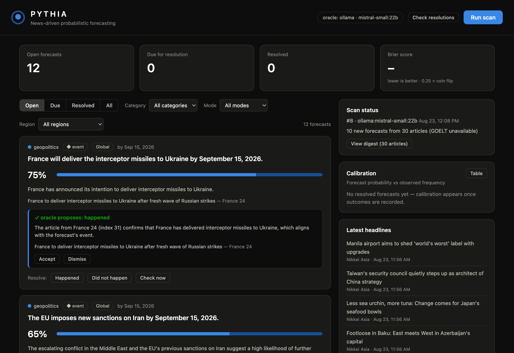

# Pythia

**A self-measuring forecasting system.** Pythia reads the world's news, states
the odds of what happens next in concrete falsifiable terms — and is scored on
every answer it ever gives.



Most AI demos ask to be believed. This one keeps a ledger: every forecast has a
deadline, every resolution is recorded, and the dashboard shows the Brier score
and calibration curve that say whether any of it is any good. It runs entirely
on one machine against a local open model, with the Claude API one key away.

A news-driven probabilistic forecasting system. Pythia scans a configurable
set of RSS feeds, asks a language model to turn the day's news into **concrete,
falsifiable forecasts** (statement, probability, horizon date, category, evidence),
and keeps a **resolution ledger** so the system's calibration is measurable over
time (Brier score, calibration curve).

> Forecasts are LLM-generated probabilistic estimates for research and
> experimentation. They are not advice — financial, investment, or otherwise.

## Architecture

```
RSS feeds ──> feeds.py ──> SQLite (articles)
                              │
                              ▼
                        pipeline.py ──> oracle (Anthropic Claude API │ local Ollama)
                              │              structured JSON forecasts
                              ▼
                        SQLite (predictions ledger)
                              │
                              ▼
                        FastAPI ──> static dashboard (forecasts, resolution, calibration)
```

## Quick start

Requires Python 3.12+ and either a local [Ollama](https://ollama.com) model
(fully on-premise, nothing leaves your machine) or an Anthropic API key.

```bash
git clone https://github.com/egsamaras/pythia.git
cd pythia
python3 -m venv .venv
.venv/bin/pip install -e ".[dev]"
```

Then start it — with a local model:

```bash
PYTHIA_PROVIDER=ollama PYTHIA_OLLAMA_MODEL=mistral-small:22b \
  .venv/bin/python -m uvicorn --app-dir src pythia.server:app --host 127.0.0.1 --port 8792
```

…or with the Claude API (`export ANTHROPIC_API_KEY=…` first, then omit the
provider variables). Open **http://127.0.0.1:8792** and press **Run scan**.
A local 22B model takes 10–20 minutes per scan on a laptop; Claude takes
under a minute.

Verify the install without any model or network access:

```bash
.venv/bin/python -m pytest
```

## Run

```bash
.venv/bin/python -m uvicorn --app-dir src pythia.server:app --host 127.0.0.1 --port 8792
```

The server binds to localhost and has **no authentication** — do not expose it.

## Oracle backends

| Backend | When used | Model (default) |
|---|---|---|
| Anthropic Claude API | `ANTHROPIC_API_KEY` / `ANTHROPIC_AUTH_TOKEN` present (or forced) | `claude-opus-5` |
| Local Ollama | No Anthropic credentials and Ollama reachable (or forced) | `llama3.1:8b` |

Auto-detection prefers the Claude API when credentials exist; otherwise it falls
back to local Ollama — fully on-premise, no data leaves the machine. Forecast
quality tracks the model: a small local model produces noticeably rougher
forecasts than Claude Opus 5.

On the Anthropic backend, server-side **refusal fallbacks** are enabled by
default (`fallbacks="default"`): if the primary model declines a request for
safety reasons, the API retries it on a fallback model within the same call.
Set `PYTHIA_ANTHROPIC_FALLBACKS=0` to disable.

## Configuration (environment variables)

| Variable | Default | Purpose |
|---|---|---|
| `PYTHIA_PROVIDER` | `auto` | `auto` \| `anthropic` \| `ollama` |
| `PYTHIA_ANTHROPIC_MODEL` | `claude-opus-5` | Claude model id |
| `PYTHIA_ANTHROPIC_FALLBACKS` | `1` | server-side refusal fallbacks |
| `PYTHIA_OLLAMA_URL` | `http://localhost:11434` | Ollama server |
| `PYTHIA_OLLAMA_MODEL` | `llama3.1:8b` | local model |
| `PYTHIA_DB` | `~/Library/Application Support/Pythia/pythia.db` | SQLite path |
| `PYTHIA_MAX_RESOLUTION_FORECASTS` | `20` | open forecasts per resolution check |
| `PYTHIA_AUTO_UPDATE` | `1` | oracle probability updates on open forecasts |
| `PYTHIA_BACKUP_DIR` | `~/Documents/pythia-backups` | ledger snapshot directory |
| `PYTHIA_BACKUP_KEEP` | `14` | snapshots retained |
| `PYTHIA_GDELT` | `1` | GDELT structured signals per scan |
| `PYTHIA_GDELT_WATCHES_FILE` | `gdelt.txt` | watch-query definitions |
| `PYTHIA_FEEDS` | — | comma-separated RSS URLs (overrides the feeds file) |
| `PYTHIA_FEEDS_FILE` | `feeds.txt` | path to the feeds file |
| `PYTHIA_FEED_TIMEOUT_S` | `15` | per-feed HTTP timeout |
| `PYTHIA_ORACLE_TIMEOUT_S` | `1800` | model request timeout (large local models are slow) |
| `PYTHIA_MAX_ARTICLES_ANTHROPIC` | `80` | article batch cap (Claude) |
| `PYTHIA_MAX_ARTICLES_OLLAMA` | `30` | article batch cap (Ollama) |

## News sources

The active source list lives in [feeds.txt](feeds.txt) — one URL per line,
`#` for comments; edit it and restart the server. It ships with ~48 verified
feeds across seven groups: global news (BBC, Guardian, NYT, WSJ, Sky,
France 24, DW), business & markets (MarketWatch, CNBC, FT, The Economist),
**conflict & security analysis** (Crisis Group, War on the Rocks, Defense One,
Breaking Defense, The War Zone, Foreign Policy, CFR), **government primary
sources** (UN press, US travel advisories, Pentagon, White House, UK FCDO,
IAEA), regional depth (Arab News, The National, Middle East Eye, SCMP, Nikkei
Asia, The Hindu, AllAfrica, MercoPress), **Bluesky account feeds**
(`bsky.app/profile/<handle>/rss` — add any handle you trust; X/Twitter has no
free API, but much of the OSINT community posts on Bluesky), and **Google News
query feeds** — topic radar plus early-warning searches (mobilization,
embassy evacuations, martial law/coups, ISW assessments, sanctions
designations) that also surface Reuters/Bloomberg stories. Query-feed items
are labeled "(via Google News)" so curated and uncurated publishers never
blur.

### Structured signals (GDELT)

Beyond editorial feeds, each scan reads **GDELT** — the open Global Database
of Events, Language and Tone, which machine-codes worldwide news in 100+
languages, keylessly, on a 15-minute cadence. For every watch query in
[gdelt.txt](gdelt.txt) (Iran, Russia–Ukraine, China–Taiwan, Israel–Levant,
Gulf, coups/emergencies by default), Pythia pulls the newest worldwide
articles (labeled "(via GDELT)", non-English items flagged) and computes an
**escalation ratio** — the last 48 hours of coverage volume against the
prior 12-day baseline, normalized against total global output. The ratios
form a snapshot injected into the forecast prompt as machine-computed
signals, stored on the scan row, and shown in the digest — so what the
oracle read is always auditable. The snapshot itself carries the caveat:
coverage volume measures the world's *attention*, not verified events.
Disable with `PYTHIA_GDELT=0`; a failed pull never blocks a scan.

**Known limitation.** GDELT's free DOC API allows one request every five
seconds per IP, and a burst trips a cooldown longer than that. On a shared or
carrier-NAT'd connection the quota is consumed by other users on the same
public address, and every pull returns HTTP 429 regardless of how politely
this client behaves — observed on the author's own network, where scheduled
runs report "GDELT unavailable" from the first request. The scan degrades
cleanly and says so. If you need the signals reliably, GDELT's bulk 15-minute
export files carry no rate limit and would suit a different adapter.

Feeds are fetched concurrently and capped at 25 entries each per fetch. The
analysis batch pools the newest few articles **per feed** (so a
weekly-publishing analysis shop is never drowned out by the wires) and
round-robins across feeds; in-place republications — a travel advisory
escalating under the same URL — refresh the stored article and re-enter the
pool. Precedence: `PYTHIA_FEEDS` env var > `PYTHIA_FEEDS_FILE` > `feeds.txt`
in the project root > a built-in minimal list.

## The forecasting loop

1. **Scan** — fetch feeds, deduplicate articles by URL, send a source-balanced
   batch to the oracle with the list of already-open forecasts (to avoid
   duplicates).
2. **Forecasts** — each has a falsifiable statement, a probability (0.01–0.99),
   a horizon date, a category, a rationale, and links to the motivating
   articles, and a **region** tag — the region primarily affected, or
   `global` when the consequences are worldwide — filterable in the
   dashboard. Every forecast uses one of three **modes**:
   - **event** — the news says something may happen; will it actually happen?
   - **consequence** — a downstream outcome the articles don't discuss (market
     move, policy response), with the causal chain stated in *basis*.
   - **precedent** — reference-class forecasting: the closest historical
     analogues and their base rate, stated in *basis*
     ("6 of 8 emergency OPEC meetings since 2008 ended in a quota cut").
3. **Resolve** — when a horizon passes ("due" badge), mark the outcome:
   *Happened* / *Did not happen*. Or press **Check resolutions**: the oracle
   re-reads the news (plus archived coverage matched to overdue forecasts)
   and *proposes* resolutions with cited evidence — you accept or dismiss
   each. Proposals are deliberately conservative: an event's absence from a
   small news batch is never treated as proof it didn't happen, and a
   dismissed proposal is not re-raised unless the oracle changes its verdict.
4. **Update** — the self-learning layer. Resolution checks (including the
   per-forecast **Check now** button) can revise an open forecast's
   probability when cited new evidence shifts the odds; every revision is
   kept in an audit history and shown on the card. Once 30 forecasts have
   resolved, the system's measured calibration record is fed back into the
   forecast prompt so it corrects its own biases.
5. **Calibration** — the dashboard tracks the Brier score (0 = perfect,
   0.25 = coin flip), a calibration curve, and a per-mode Brier breakdown.
   Resolved forecasts are scored on their **time-weighted lifetime
   probability**, so late revisions can't game the ledger — it measures
   sustained judgment over the forecast's whole life.

## Headless runs & scheduling

```bash
.venv/bin/python -m pythia.cli scan          # one forecast scan
.venv/bin/python -m pythia.cli check         # one resolution check
.venv/bin/python -m pythia.cli daily         # check, then scan (the morning routine)
.venv/bin/python -m pythia.cli backup        # snapshot the ledger now
.venv/bin/python -m pythia.cli prune --dry-run   # list unusable open forecasts
.venv/bin/python -m pythia.cli schedule --hour 7 --minute 30
```

`schedule` writes a launchd agent (`~/Library/LaunchAgents/com.pythia.daily.plist`)
that runs `daily` every morning and logs to `~/Library/Logs/pythia.log`; it
prints the `launchctl load -w …` command but never activates anything itself.
Current `PYTHIA_*` variables are captured into the agent; secrets are not.
CLI and server share the database safely: each refuses to start a run while
the other has one in flight.

## First results

The ledger's first resolutions, 12 October 2026 — four forecasts made on
23 August by `mistral-small:22b`, resolved against the public record:

| Forecast | Said | Outcome |
|---|---|---|
| EU imposes new sanctions on Iran by 15 Sep | 65% | did not happen |
| France delivers interceptor missiles to Ukraine by 15 Sep | 75% | did not happen |
| EU imposes new sanctions on Russia by 30 Sep | 65% | happened |
| EU does *not* impose new sanctions on Iran by 30 Sep | 40% | happened |

**Brier score 0.367.** A coin flip scores 0.25, so the system's first measured
verdict on itself is *worse than chance*. Hit rate 1 in 4. Every miss runs the
same way — confident that a proposed diplomatic action would occur — and the
one hit was the EU's most routine, highest-base-rate activity. Two further
forecasts were [voided](#voiding-an-unscoreable-forecast) as unscoreable
rather than guessed.

Four data points carry no statistical weight, and the calibration feedback
loop stays silent until thirty. But the number is real, it is published here
rather than buried, and that is the entire argument of the project: a
forecasting system that cannot embarrass itself isn't measuring anything.

## Voiding an unscoreable forecast

Not every statement a model produces can be settled. *"The campaign will lead
to a cyberattack on a major European city"* has no clean yes or no, and
forcing one would put a coin-flip into the calibration record.

**Void** retires such a forecast without scoring it, recording why. Voided
forecasts are excluded from every scoring query, so they never touch the Brier
score or the calibration curve, but they stay visible under the Void filter —
the ledger keeps an honest trace that the system produced something
unscoreable rather than hiding it. A voided statement is also blocked from
being proposed again, since re-offering a claim you have already judged
unscoreable is just noise. Reopening a void returns it to the ledger and
clears both.

Scoring a void directly is refused: it has to be reopened first, so the intent
is on the record.

## Statement hygiene

The prompt tells the model to state each claim once, in the positive, as a
future event. Mid-size local models comply unevenly, so the rules are
**enforced in code** rather than merely requested:

- a statement reciting history (`"6 of 8 past meetings ended in a cut"`) is
  refused — that belongs in the forecast's `basis`, and as a statement it
  could never be resolved;
- a restatement of an open claim is refused, including a reconjugated one
  (`"The EU imposes…"` vs `"The EU will impose…"`);
- **a claim and its negation can never both be open.** Scoring X and NOT-X
  together guarantees one hit and one miss whatever the model's skill,
  manufacturing a ~0.25 Brier score out of nothing — which would quietly
  destroy the only thing this system claims to offer.

Forecasts stored before those gates existed can be retired with
`pythia.cli prune` (`--dry-run` lists them first). Resolved forecasts are
never touched: the ledger's history is append-only.

## Backups

The ledger is the one thing here that cannot be reconstructed — forecasts are
tied to the news batch and the moment they were made, and resolutions carry
researched evidence. The daily run snapshots it to `~/Documents/pythia-backups`
before doing anything else, keeping the most recent 14 and pruning the rest;
`pythia.cli backup` does the same on demand.

Snapshots use SQLite's backup API rather than a file copy, so a scan running
at the same time cannot produce a torn file. They land in the cloud-synced
Documents tree on purpose: the live database stays out of it because sync
corrupts SQLite's WAL sidecars, but a finished snapshot is an inert file, and
an off-machine copy is the point. Override with `PYTHIA_BACKUP_DIR` and
`PYTHIA_BACKUP_KEEP`. A failed backup is logged and never stops the run.

## Database location

The database lives at `~/Library/Application Support/Pythia/pythia.db` —
deliberately outside Documents, which is often iCloud-synced (iCloud corrupts
SQLite WAL sidecar files). On first start after upgrading, an existing legacy
database at `data/pythia.db` is copied across automatically (WAL-safely); the
legacy file is left untouched and can be deleted once you've confirmed the
move.

## Tests

```bash
.venv/bin/python -m pytest
```

Tests run without network or model access (synthetic feeds, fake oracle).

## Prototype status

This is a runnable end-to-end prototype, not a production deployment. Known gaps
before production use: no authentication or multi-user support, no feed-level
rate limiting, and no monitoring beyond logs. See
[limitations.md](limitations.md) for model- and data-level caveats.
